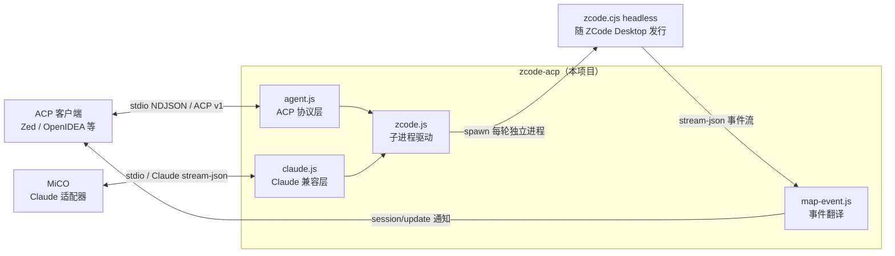
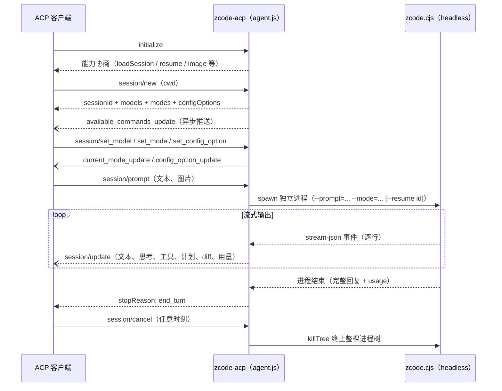
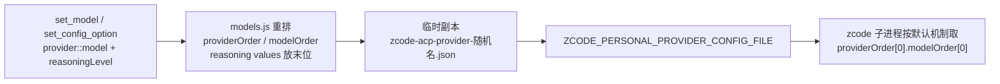

# ACP 与 zcode-acp：把 ZCode 接入任意编辑器（技术分享）

面向技术分享（15~25 分钟），覆盖 ACP 协议是什么、本项目如何实现，含架构 / 时序图、
核心模块、关键设计、协议映射、安全边界与当前限制。
对应 `@luyi0825/zcode-acp` 0.5.3；最后更新：2026-11-15。

## 议程

| 环节 | 内容 | 时长 |
| --- | --- | --- |
| 1 | ACP 是什么 | 3 分钟 |
| 2 | 项目定位与整体架构 | 3 分钟 |
| 3 | 一次对话的生命周期 | 4 分钟 |
| 4 | 核心模块 | 2 分钟 |
| 5 | 关键设计 | 5 分钟 |
| 6 | 协议映射 | 3 分钟 |
| 7 | 安全边界 | 2 分钟 |
| 8 | 当前限制与延伸 | 2 分钟 |

## 1. ACP 是什么

**ACP（Agent Client Protocol）** 是编辑器 / IDE 与 coding agent 之间的标准通信协议
（见 [agentclientprotocol.com](https://agentclientprotocol.com/) 与
[协议概览](https://agentclientprotocol.com/protocol/v1/overview.md)）。

- 它标准化的是「客户端 ↔ agent」这一段：会话生命周期、用户 prompt、工具调用流、
  文本 / 思考 / 计划 / diff 等 UI 更新。
- 典型形态：客户端把 agent 作为**本地子进程**拉起，双方通过 **stdio 以 JSON-RPC 风格的
  请求 / 响应 / 通知**交互，逐行一帧（NDJSON）。**本项目实现的即这种形态：NDJSON ACP v1**。
- 远程 HTTP / WebSocket 等传输属于协议生态内容，**本项目未实现**。

与另外两个常听到的协议对比（互补关系，不存在谁替代谁）：

| 协议 | 标准化什么 | 典型场景 |
| --- | --- | --- |
| LSP | 编辑器 ↔ 语言服务 | 补全、跳转、诊断 |
| MCP | agent ↔ 外部工具 / 数据源 | 给模型接数据库、文件系统 |
| ACP | 编辑器 / IDE ↔ 编码 agent | 会话、工具调用流、diff / 计划等 UI 更新 |

## 2. 项目定位与整体架构

**zcode-acp 不实现 agent 内核，只做协议翻译**。ZCode 的 agent 能力（工具、skills、
MCP、hooks、多轮上下文）全部来自随 ZCode Desktop 发行的 CLI 本体（`zcode.cjs`），
zcode-acp 按标准安装路径自动定位并用系统 Node 驱动它。

两个入口共用同一套执行内核（`runTurn`）：

- **ACP 服务入口**：无参数 / `serve` / `acp` / `--yolo` 启动 stdio ACP 服务
  （`acp` 是 ACP 生态约定的入口名；`--yolo` 兼容 MiCO qoder 适配器的拉起方式）；
- **MiCO Claude 兼容入口**：`zcode-acp -p --input-format stream-json --effort <level>`，
  是为 MiCO 增加的最小兼容层，**不是完整的 Claude 协议实现**。

## 3. 一次对话的生命周期

要点：

- `initialize` 声明 `loadSession`、`sessionCapabilities.resume`、
  `promptCapabilities.image`（audio / embeddedContext 为 false）、`mcpCapabilities` 关闭、
  `authMethods`（凭据由 zcode CLI 持有，客户端无需填写，`authenticate` 不读参数）。
- `session/new` 返回真实模型列表（`availableModels` / `currentModelId`）、权限模式
  （`modes`）、思考级别（`configOptions`，`category: thought_level`），客户端的模型 /
  思考 / 模式选择器直接可用。
- `session/load` 与 `session/resume` 用于宿主兼容：重建会话记录让后续 prompt 可用，
  **不重放历史**。
- 同一会话内 prompt 串行：并发 prompt 直接回 `refusal`，避免争抢 zcode 侧 sessionId。
- 多轮上下文由 zcode 侧的 `--resume <zcodeSessionId>` 续接（ACP sessionId 与
  zcodeSessionId 的映射存在 zcode-acp 内存里）。

## 4. 核心模块

| 模块 | 职责 |
| --- | --- |
| [`bin/cli.js`](../bin/cli.js) + [`src/cli.js`](../src/cli.js) | npm / exe 共用入口与命令分发：无参数、`serve`、`acp`、`--yolo` → ACP 服务；`-p --input-format stream-json` → Claude 兼容入口；`login` / `logout` / `doctor` / `setup` |
| [`src/agent.js`](../src/agent.js) | ACP 协议层：initialize、session/new/load/resume、prompt、cancel、set_model / set_mode / set_config_option；会话记录、图片附件 |
| [`src/zcode.js`](../src/zcode.js) | 定位 zcode.cjs、spawn 每轮 headless 进程、解析 stream-json、killTree 进程树终止 |
| [`src/map-event.js`](../src/map-event.js) | stream-json → ACP session/update 的纯翻译 |
| [`src/emitter.js`](../src/emitter.js) | 会话通知发送（update / 助手文本 / 命令菜单） |
| [`src/models.js`](../src/models.js) | 模型列表（personal provider config）、`provider::model` 编码、选型副本生成 |
| [`src/commands.js`](../src/commands.js) | 命令 / 技能 / 子 agent 发现（`commands list --json`、`skills list --json`、`agents/*.md`），进程级缓存 |
| [`src/slash-text.js`](../src/slash-text.js) | `/技能名` → `/skill 技能名` 文本改写 |
| [`src/subagents.js`](../src/subagents.js) | `~/.zcode/agents/*.md` 子 agent 清单 |
| [`src/runtime-env.js`](../src/runtime-env.js) | env-file 继承（`~/.zcode-acp.env`），键白名单与路径防御 |
| [`src/login.js`](../src/login.js) | login / logout 代理直通 zcode CLI |
| [`src/doctor.js`](../src/doctor.js) | doctor 自检、setup（Desktop 运行时变量导出） |
| [`src/register.js`](../src/register.js) | 向 OpenIDEA / Zed 发现位置写入 agent 入口 |
| [`src/claude.js`](../src/claude.js) | MiCO 的 Claude stream-json 最小兼容入口（发现 / 单轮 / resume / interrupt） |

## 5. 关键设计

### 5.1 每轮独立进程，多轮靠 `--resume`

headless（`-p`）是一次性进程模型：每轮 prompt 独立 spawn
`node zcode.cjs --prompt=<text> --output-format stream-json --cwd <cwd> --mode=<mode> [--resume <id>]`，
多轮上下文靠 `--resume <zcodeSessionId>` 续接。zcodeSessionId 从事件流里抓取，
与客户端的 ACP sessionId 做内存映射。好处：进程生命周期天然隔离，取消 = 杀进程树；
代价：zcode-acp 重启丢映射（见第 8 节）。

### 5.2 模型与思考级别 = provider 配置副本

headless 没有 `--model` / 思考级别参数（实测逆向 zcode CLI 得出）：

- 默认模型 = provider 配置里 `providerOrder[0]` 的 `modelOrder[0]`；
- 默认思考级别 = 该模型 `optionSpecs.reasoningLevel.values` 的**末位**；
- 可选档位由 personal 与 builtin 的通用模型、API、站点、模板和 provider 规则按顺序合并；
- `ZCODE_PERSONAL_PROVIDER_CONFIG_FILE` 允许重定向到副本文件。

`session/set_model` 后会立即广播 `config_option_update`，让客户端刷新为当前模型的
档位；旧选择不兼容时清空，由新模型末位档位作为默认值。

因此 `session/set_model` / `session/set_config_option` 的实现是：生成一份把选中项
**重排到位的一次性 provider 配置副本**（临时目录、随机文件名），通过环境变量只传给
对应当轮子进程，不修改原始 provider 配置。

### 5.3 两个防注入细节

- **提示词用 `--prompt=<text>` 等号形式**：值是完全外部输入，若作为独立 argv 出现，
  以 `-` 开头会被 zcode 当成选项。等号形式让整个值固定绑定在选项上。
- **权限模式双重白名单**：选择器只展示 plan / build / guarded / yolo，edit 仅作旧客户端
  兼容输入；agent 层校验后，spawn 前再按 ZCode 支持的白名单检查，非法值回落 yolo。

### 5.4 图片管道

ACP 的 image block（PNG / JPEG / GIF / WebP）→ base64 解码写入本轮临时目录
（MIME 白名单映射为固定扩展名，MIME 本身不进文件路径）→ prompt 附「请使用 Read 工具
读取以下图片」→ `finally` 删除临时目录。

### 5.5 技能命令改写

zcode 的斜杠注册表只含自定义命令，裸写 `/技能名` 会得到 "Unknown command"。zcode-acp 在
`session/prompt` 与 Claude 入口统一把**行首**的 `/技能名` 改写成 `/skill 技能名`
（只命中本机技能白名单才改写；同名自定义命令优先、不改写）。

### 5.6 取消与进程树终止

`session/cancel` → stop 回调 → killTree：Windows 用 `taskkill /T /F` 连 shim 带真身
及孙进程一并终止（PATH 上的 node 可能是版本管理器 shim，只杀 shim 会导致 close 永不
触发）；POSIX 以 detached 自成进程组、按组 SIGKILL。

### 5.7 宿主兼容取舍

- `session/load` / `session/resume` 只重建会话记录，不重放历史（zcode-acp 不持久化消息）；
- 命令菜单在 `session/new` 响应之后**异步**推送（读命令要起子进程，约百毫秒级）；
- 会话更新通知**不等客户端确认**：单条失败不阻断整轮执行。

## 6. 协议映射

### 6.1 请求 / 响应一览

| ACP 请求 | 行为 |
| --- | --- |
| `initialize` | 能力协商（见第 3 节） |
| `authenticate` | 不执行交互登录，沿用 ZCode CLI / Desktop 的认证环境 |
| `session/new` | 签发 sessionId，返回 models / modes / configOptions |
| `session/load`、`session/resume` | 重建会话记录（宿主兼容，不重放历史） |
| `session/prompt` | spawn 一轮 zcode，流式回 update，返回 stopReason |
| `session/cancel`（通知） | 终止本轮进程树 |
| `session/set_model`（部分宿主的私有扩展） | 记录选中模型，并广播该模型的思考档位；旧档位不兼容时回退默认值 |
| `session/set_mode` | 记录模式，广播 `current_mode_update` |
| `session/set_config_option` | 记录思考级别，广播 `config_option_update` |

### 6.2 stream-json → ACP session/update

| zcode 事件 | ACP update | 说明 |
| --- | --- | --- |
| `model.streaming` / `text_delta` | `agent_message_chunk` | 助手文本增量 |
| `model.streaming` / `reasoning_delta` | `agent_thought_chunk` | 推理过程增量 |
| `tool.updated` / `scheduled` | `tool_call`（pending） | 建工具卡；TodoWrite 另转 `plan`；Write 从入参合成新文件 diff |
| `tool.updated` / `started` | `tool_call_update`（in_progress） | 开始执行 |
| `tool.updated` / `result` | `tool_call_update`（completed / failed） | 附输出文本与 diff（unified hunk 拆成改前 / 改后两侧） |
| `session.updated`（usage + contextWindow） | `usage_update` | token 用量 |
| `session.titleUpdated` | `session_info_update` | 会话标题 |

其余事件（hook、checkpoint、batch 汇总）忽略，避免污染客户端 UI；超长内容按
文本 20000 / 工具输出 4000 / 标题 160 裁剪。

### 6.3 MiCO Claude 兼容层映射

| Claude stream-json | 行为 |
| --- | --- |
| `control_request/initialize` | 回 `control_response`：命令 / 子 agent / 模型清单，逐模型声明 `supportedEffortLevels` |
| `control_request/interrupt` | 停止本轮（killTree） |
| `user` 消息 | 走 `runTurn` 单轮执行 |
| 输出 | `system/init` + 整段 `assistant` + `result`（非流式转发） |
| `--effort` | 与 ZCode 使用同名档位，只接受当前模型实际支持的值；不支持的值回退模型默认值 |
| `--permission-mode` | `plan` → plan，其余 → yolo |

## 7. 安全边界

> **默认 yolo 是最大的风险面**：headless 运行没有确认入口，agent 会无确认地读写文件、
> 执行命令。只把 zcode-acp 接入你信任的客户端与项目；需要受控执行时切 plan（只读）/
> guarded（守卫模式）。

输入与寻址防御（均在代码里可见）：

- **cwd 归一化**：必须是存在的绝对目录，否则回退用户主目录，杜绝相对路径进入 `--cwd`；
- **会话 id 等值比对**：客户端回传的 sessionId 只与本地签发值比对，外部值不参与寻址；
- **argv 防注入**：提示词 / 模式用 `--opt=<value>` 等号形式；`execFile` 显式
  `shell: false` 且 argv 全为字面量；环境变量只表达「安装目录」，可执行文件仍由固定
  相对路径派生；
- **mode 双重白名单**：非法值不可能以任意形态进入命令行；
- **图片 MIME 固定扩展名**：MIME 不进文件路径；临时目录用后即删；
- **env-file / provider config 防御**：路径必须绝对、规范化后不得含 `..`、必须是
  普通文件；env-file 只接受键白名单，已有值优先不覆盖；
- **子 agent 文件白名单**：文件名正则限定 + realpath 校验父目录不逃逸，单文件异常只
  跳过自己。

凭据与隐私：

- `authenticate` 不执行交互登录，浏览器授权与凭据加密由 zcode CLI 负责；独立登录凭据存
  `~/.zcode/v2/credentials.json`（AES-256-GCM，密钥存 OS keyring；无 keyring 环境用
  `ZCODE_CREDENTIAL_SECRET`）；
- zcode-acp 会按白名单继承 Desktop 的运行时 token，并读取、复制完整 provider 配置。因此
  `~/.zcode-acp.env` 与 `zcode-acp-provider-*.json` 都应按敏感文件保护，不能外发；
- ACP 传输是本机 stdio，zcode-acp 自身不发起网络请求；模型调用全部经 zcode CLI。

## 8. 当前限制

- **会话与选择只存内存**：zcode-acp 重启后 zcodeSessionId 映射、模型 / 思考级别 / 模式
  选择全部回到默认；`session/load` / `session/resume` 只重建记录，**不重放历史**。
- **临时 provider 副本由 OS 清理**：留在系统临时目录，zcode-acp 不主动删除。
- **默认 yolo 与 cwd 信任边界**：安全依赖「只接入信任的客户端 / 项目」这一使用约定。
- **Claude 兼容层是最小实现**：只覆盖 MiCO 实际下发的单轮消息、模型 / 命令发现、
  `--resume` 与 interrupt，不是完整 Claude Code 流式协议（输出为整段 assistant + result）。
- **多媒体与 ACP MCP 透传未支持**：`promptCapabilities` 仅 image（audio /
  embeddedContext 为 false）；不接收客户端通过 ACP 下发的 HTTP / SSE MCP 配置，
  但 ZCode CLI 自身已配置的 MCP 能力不受影响。
- **仅 stdio**：远程 HTTP / WebSocket 传输是协议生态内容，本项目未实现。
- **模型列表降级**：读不到 personal provider config 时回退单模型声明，保链路不断。
- **MiCO 各 protocol family 的入口差异**（acp 未接入模型发现、qoder / kimi 无思考档位）
  是 MiCO 0.6.216 的版本行为，不是 ACP 协议本身的限制。

## 9. 延伸与参考

- ACP 官方：[agentclientprotocol.com](https://agentclientprotocol.com/)、
  [协议概览](https://agentclientprotocol.com/protocol/v1/overview.md)
- OpenIDEA：[agents 配置](https://openidea.sh/zh/guide/agents)、
  [数据目录](https://openidea.sh/zh/reference/data-directories)
- 仓库内：[README](../README.md)（快速开始与开发）、
  [使用指南](usage-guide.md)（安装 / 接入 / 排障）
- 开发自测：`npm test`（隔离回归，不调用真实模型）、`npm run smoke`（协议自测，
  需要本机已登录 zcode）
